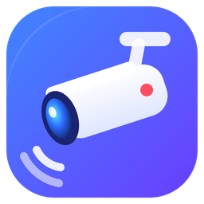
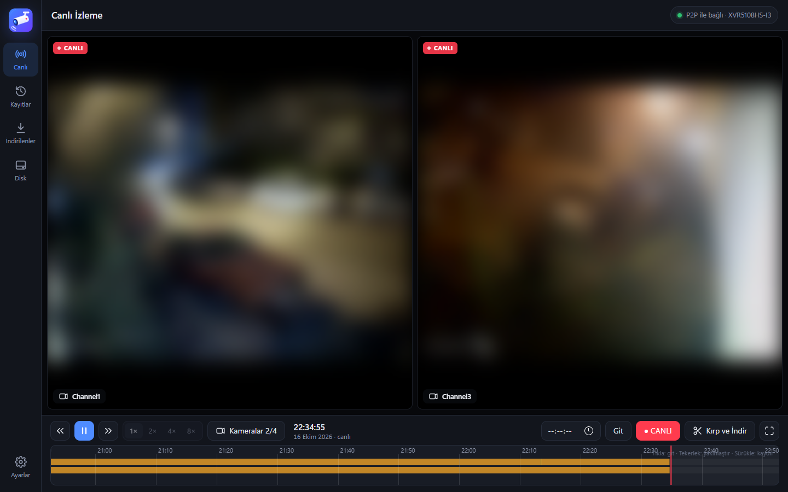
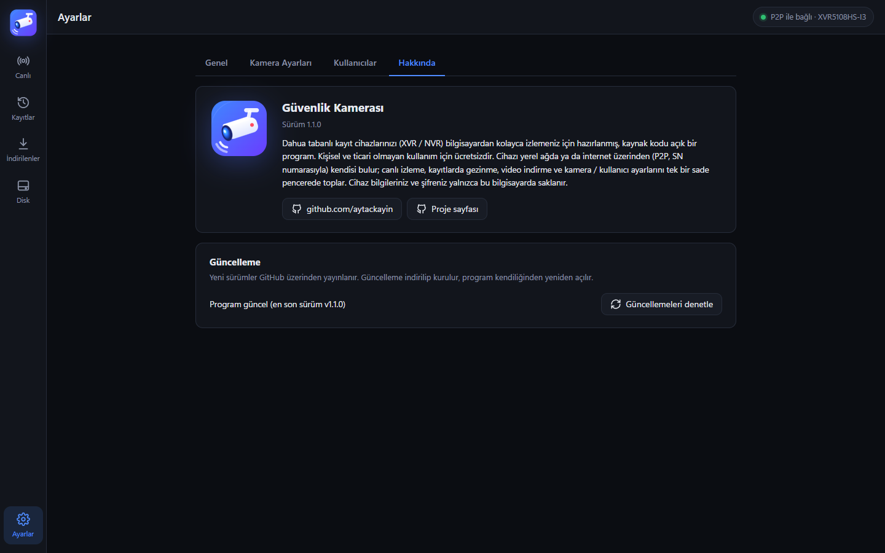

<p align="center">
  
</p>

<h1 align="center">Güvenlik Kamerası</h1>

<p align="center">
  Dahua tabanlı kayıt cihazlarınızı (XVR / NVR) Windows bilgisayardan kolayca izlemek için sade ve modern bir program.
  <br>
  <a href="https://github.com/aytackayin/guvenlik-kamerasi/releases/latest"><b>⬇ Son sürümü indir</b></a>
</p>



<sub>Ekran görüntüsündeki kamera görüntüleri gizlilik için bulanıklaştırılmıştır.</sub>

## Neler yapabilir?

- **Kendiliğinden bağlanır:** Cihazı yerel ağda bulur; ağ dışındaysanız DMSS'in yaptığı gibi internet üzerinden (P2P, SN numarasıyla) bağlanır. Port yönlendirme gerekmez.
- **Canlı izleme:** Tüm kameralar ızgarada, çift tıkla tek kamera, yakınlaştırma, tam ekran ve kare alma.
- **Kayıtlar:** Zaman çizelgesinde gün gün gezinme, 1×–8× hızlı oynatma, kare kare ilerleme.
- **Kırp ve indir:** Kaydın istediğiniz bölümünü MP4, H.264, MKV, AVI, WebM ya da DAV olarak indirin.
- **Disk ve kullanıcılar:** Disk durumunu görün, cihaz kullanıcılarını ve kamera ayarlarını (çözünürlük, fps, kalite) programdan yönetin.
- **Tray'de çalışır:** İsterseniz pencereyi kapattığınızda program kapanmaz, saat yanındaki bildirim alanında çalışmaya devam eder. Windows açılınca kendiliğinden başlayabilir ve aynı anda yalnızca bir kopyası açılır. Simgeye çift tıklayınca pencere açılır, tek tıklayınca menü gelir: **Aç**, **Bağlantıyı kapat / aç**, **Kapat**.
- **Kendini günceller:** *Ayarlar → Hakkında* bölümünden yeni sürüm denetlenir ve tek tıkla kurulur.



## Kurulum

1. [Releases](https://github.com/aytackayin/guvenlik-kamerasi/releases/latest) sayfasından `GuvenlikKamerasi-<sürüm>-windows.zip` dosyasını indirin.
2. Zip'i istediğiniz bir klasöre çıkarın (ör. `Belgeler\Güvenlik Kamerası`).
3. İsterseniz klasördeki **Masaüstüne kısayol ekle.bat** ile masaüstü ve Başlat menüsü kısayolu oluşturun.
4. **Güvenlik Kamerası.exe**'yi çalıştırın, *Ayarlar*'da cihazınızın SN numarasını, kullanıcı adını ve şifresini girin.

Program penceresi için bilgisayarda Microsoft Edge (Windows'ta hazır gelir) ya da Google Chrome bulunması yeterlidir. Başka bir şey kurmanız gerekmez.

> **Gizlilik:** Cihaz bilgileriniz ve şifreniz yalnızca bu bilgisayarda (`%APPDATA%\GuvenlikKamera`) saklanır, şifre Windows tarafından şifrelenir. Program hiçbir bilgiyi başka bir yere göndermez; tek dış bağlantısı cihazınız ve güncelleme denetimi için GitHub'dır.

## Güncelleme

*Ayarlar → Hakkında → Güncellemeleri denetle* düğmesine basın. Yeni sürüm varsa sürüm notları gösterilir; **Güncelle** dediğinizde program yeni sürümü indirir, kendini kapatıp dosyaları değiştirir ve yeniden açılır. Ayarlarınız ve indirdiğiniz kayıtlar korunur. Program açılışta da sessizce denetler ve yeni sürüm varsa bildirir.

## Kaynak koddan çalıştırma

Gerekenler: Python 3.12+, PATH'te `ffmpeg` / `ffprobe`.

```bash
pip install -r requirements.txt
python app/main.py
```

Kaynak koddan çalışırken güncelleme için `git pull` kullanın.

### Paketleme

```bash
pip install pyinstaller pillow
paketleme\derle.bat
```

Çıktı `dist\Güvenlik Kamerası` klasörüne yazılır. Simgeler `web/logo.svg` dosyasından üretilir.

## Desteklenen cihazlar

Dahua XVR5108HS-I3 üzerinde geliştirilip denendi. Aynı yazılımı kullanan Dahua XVR / NVR modelleri (ve Dahua altyapılı markalar) büyük olasılıkla çalışır.

## Üçüncü taraf yazılımlar

Hazır paket, video dönüştürme için [FFmpeg](https://ffmpeg.org) (`ffmpeg.exe`, `ffprobe.exe`) içerir. FFmpeg kendi lisansıyla (GPL) dağıtılır; kaynak koduna ffmpeg.org adresinden ulaşabilirsiniz.

Bu proje Dahua Technology ile ilişkili değildir.

## Lisans

[PolyForm Noncommercial 1.0.0](LICENSE) © Aytaç KAYIN

- ✅ Kişisel kullanım, ev, okul, dernek gibi **ticari olmayan** her türlü kullanım serbest ve ücretsizdir.
- ✅ Kodu inceleyebilir, değiştirebilir ve ticari olmayan amaçla paylaşabilirsiniz (lisans metni ve telif satırı korunarak).
- ❌ Programın ya da değiştirilmiş bir kopyasının **satılması, ücretli bir ürüne veya hizmete dahil edilmesi** gibi ticari kullanımlar yasaktır.

Ticari kullanım için izin almak isterseniz [GitHub](https://github.com/aytackayin) üzerinden iletişime geçin.

## Geliştirici

**Aytaç KAYIN** · [github.com/aytackayin](https://github.com/aytackayin)
